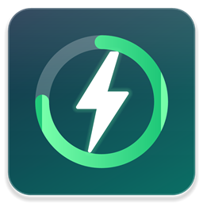

# Zaptec Monitor

[](https://github.com/kreaton/ZaptecCharger/releases/latest)
[](LICENSE)


[](https://github.com/kreaton/ZaptecCharger/stargazers)

⭐ If Zaptec Monitor earns a place on your machine, [star it on GitHub](https://github.com/kreaton/ZaptecCharger) — it's free, made by one developer, and stars are how other people find it.

**Keep an eye on your Zaptec EV charger from your Windows desktop.**

Zaptec Monitor shows what your charger is doing right now: whether a car is plugged in, how much power it's drawing, and how much energy this session has used. You can pause and resume charging, and set a daily time window so the car charges when power is cheap.

## Install

**[Download the installer](https://github.com/kreaton/ZaptecCharger/releases/latest/download/ZaptecMonitor-win-Setup.exe)** and run it. If your PC doesn't have the .NET 10 Desktop Runtime yet, the installer adds it.

The installer isn't code-signed, so Windows may warn you about it. To continue, choose **More info → Run anyway**.

To get a newer version later, open **Settings (⚙) → About → Check for updates**. To remove the app, use **Settings → Apps → Installed apps** in Windows.

## Getting started

1. Start Zaptec Monitor. The first time, the settings open by themselves.
2. On the **Account** tab, enter the e-mail and password you use for the Zaptec app or [portal.zaptec.com](https://portal.zaptec.com).
3. Press **Find chargers** and pick your charger, or leave it on *First charger on the account*.
4. Press **Save**. The main window now shows your charger's status.

## What you see

- **Status**: for example *No car connected*, *Charging*, *Paused* or *Car connected, waiting to charge*.
- **Power** being drawn right now, and the **energy** used this session.
- A green dot when the charger is online, and a red dot when it's offline.
- A short note above the buttons saying why **Start** and **Pause** are or aren't available right now. Hover over a button for more.
- At the bottom: when the status was last updated, and when the next update is due.

## Start and pause

- **Pause** stops charging while the car is charging.
- **Start** resumes a session you paused. It also tries to start a car that is waiting, and if Zaptec refuses, the bottom line shows Zaptec's reason.

Zaptec decides what the app is allowed to do, so some situations can't be changed from here:

- **The car stopped on its own** (it's full, or the car's own timer stopped it): Zaptec doesn't let apps restart that session. Unplug and plug in again, or start it from the car.
- **The car is held by a schedule you set in the Zaptec app**: use **Charge now** in the Zaptec app. The schedule itself can't be changed or overridden from this app.

## Charging schedule

On the **Schedule** tab you can pick a daily window, for example 23:00–06:00. Then choose what should happen while a car is plugged in:

- **Start charging at From**: charging resumes when the window opens.
- **Pause charging at To**: charging pauses when the window closes, and stays paused until From. A car you plug in during the evening is paused too.

Turn on one or both. A window like 23:00–06:00 that crosses midnight works fine. If you press Start or Pause yourself, the schedule steps aside until the next start or pause time.

> **The app has to be running for its schedule to work.** Zaptec doesn't let other apps store a schedule on the charger. If your PC is often off at night, use the schedule in the Zaptec app instead, and don't use both at once.

## Refresh

The app checks the charger every **15 minutes** by default. You can change that on the **Refresh** tab (1 minute at least) or turn it off. To update right away, press **⟳** or **F5**. The schedule doesn't wait for a refresh: the app checks the charger exactly at your start and pause times.

A car plugged in outside the schedule window may charge until the next refresh pauses it. Lower the refresh interval if that matters to you.

## Charge history

Press the **history** button (🕘) next to refresh, or **Ctrl+H**, to open a table of how much energy was charged in each hour. Only hours with charging are listed.

- Pick a **From** and **To** date and press **Show**, or use **Last 7 days**, **Last 30 days**, **This month** or **Last month**.
- The bottom of the window shows the total kWh and how many hours and days had charging.
- Select rows and press **Ctrl+C** to paste them into Excel, or use **Export CSV…** to save the whole table.
- Times are your PC's local time. If Zaptec has no hourly readings for a session, its energy is spread evenly over the session and marked **≈**.

Zaptec keeps closed sessions for two years, so older history isn't available.

### What it cost

Pick your grid company and electricity company on the **Price** tab in Settings. The history window then also shows the price per kWh and the cost of each hour, with the total cost and the average price at the bottom. If you already use StromForbrug or StromPriser, the tab starts with the choices you made there. Press **Save** to keep them.

- Prices come from [stromligning.dk](https://stromligning.dk): spot price, your electricity company's surcharge, grid tariffs and electricity tax, for that exact hour. Choose whether they include VAT.
- The cost is an estimate. Subscriptions, refunds of electricity tax and special EV tariffs aren't included, and the charger's own losses aren't counted.
- If stromligning.dk can't be reached, the table still shows kWh and the bottom line says why the prices are missing.

## Shortcuts

| Action | Shortcut |
| --- | --- |
| Refresh now | F5 |
| Charge history | Ctrl+H |
| Open settings | Ctrl+, |

## Good to know

- Your settings are stored in `%LocalAppData%\ZaptecMonitor\settings.json`. The password is encrypted for your Windows user, so other users of the PC can't read it.
- The app talks to Zaptec's servers (`api.zaptec.com`) using your own login, and to `stromligning.dk` for electricity prices. Nothing about you is sent to stromligning.dk, only your grid company, product and the period.
- The version, build time and commit are on the **About** tab in Settings.
- This app is not made by or affiliated with Zaptec. Use it at your own risk.

---

## For developers

The app is built with WPF on .NET 10. It's split in two projects:

| Project | What it is |
| --- | --- |
| `src/Zaptec.Api` | A `net10.0` class library for the Zaptec Cloud API. It handles login, the charger list, charger state, and the pause and resume commands. It has no UI code. |
| `src/Stromligning` | Client and models for the public [stromligning.dk API](https://stromligning.dk/api), copied from the StromPriser/StromForbrug repositories. |
| `src/ZaptecMonitor` | The WPF app: main window, settings window, charge history, the schedule logic (`ChargeSchedule.cs`) and the hourly price lookup (`ElectricityPrices.cs`). |

Installs and updates use [Velopack](https://velopack.io).

To run it from source, you need the [.NET 10 SDK](https://dotnet.microsoft.com/download/dotnet/10.0):

```powershell
dotnet run --project src/ZaptecMonitor
```

`src/ZaptecMonitor/appsettings.json` holds defaults that ship next to the exe. **Keep the username and password in it empty**, because the repository and every release are public. Sign in through the Settings screen instead. The release script refuses to build if the file contains a login.

### How it talks to Zaptec

- Login is OAuth password grant on `/oauth/token`. State comes from `/api/chargers/{id}/state`, and commands go to `/api/chargers/{id}/sendCommand/{id}`.
- **Pause** is command 506 and is only accepted while charging. **Resume** is command 507 and is only accepted when the session is paused or held by a Zaptec schedule.
- Zaptec can push updates through an Azure Service Bus subscription, but Zaptec support has to enable it for each account, so the app polls instead.
- Zaptec's public API has no way to read or set the charger's own schedule, or to do what **Charge now** in the Zaptec app does.
- Charge history comes from `GET /api/sessions/archived`, which replaces `/api/chargehistory` (that one is switched off on 2027-01-01). Results are cursor-paged, and the app asks for one month at a time. Timestamps are UTC.
- Zaptec documents each session's `energyDetails` readings as cumulative, but real data is per interval: each reading is the energy since the previous one, taken on whole hours. `ChargeHistory.ToHourly` in `Zaptec.Api` handles both formats. Readings more than an hour apart mean the car was idle in between, so the energy goes into the last hour before the reading.
- Prices come from `GET https://stromligning.dk/api/prices` with `aggregation=1h`, one month per request, at least two years back. Each hour's cost is that hour's kWh times that hour's price.

### Releases

Every push to `main` builds the app on GitHub Actions and publishes a new release (`.github/workflows/release.yml`). To push without releasing, add `[skip ci]` to the commit message. You can also start a release by hand from the repository's Actions tab, or run `src\ZaptecMonitor\BuildRelease.ps1` locally. Add `-LocalOnly` to build without uploading.

The repository must stay public, because **Check for updates** reads its releases without logging in.

### Versioning

Versions look like **1.1.42**, and the full build reads like `v1.1.42 · 2026-11-08 19:30 · 30711c7` (version · build time · commit).

- **Major.Minor** is set by hand with `<MajorMinor>` in [`Directory.Build.props`](Directory.Build.props). Raise it for bigger changes.
- **The last number** is worked out by `BuildRelease.ps1`: one higher than the latest release with the same Major.Minor, or 0 for the first. It's passed to the build as `-p:BuildNumber=…`, and local builds use 0.
- **The commit** is added by the .NET SDK from git. The build time is stamped in by `Directory.Build.props`, and `src/ZaptecMonitor/BuildInfo.cs` puts it all together.

## Credits

See [CREDITS.md](CREDITS.md).

## License & Authorship

This project is distributed under the terms of the [MIT License](LICENSE).

**AI authorship note:** Most of the source code in this repository was generated with AI coding agents (Claude Code), under my direction and review. Purely AI-generated material may not be eligible for copyright protection in some jurisdictions. To the extent any part of this project is protected by copyright, it is licensed under the MIT License, and the license's warranty and liability disclaimers apply to the project as a whole.

<!-- notices:start -->
### Independent development

ZaptecCharger is an independent, personal project developed by Per Hejndorf. It is not affiliated with, endorsed by or sponsored by Microsoft or any other rights holder (including Strømligning or Zaptec ASA). Product names and logos are trademarks of their respective owners and are used only to identify the services and tools the project works with.

### Third-party notices and asset provenance

[THIRD-PARTY-NOTICES.md](THIRD-PARTY-NOTICES.md) lists every third-party library, font and online service the project uses, with version, licence, source and whether it was modified. It also records where the icons, images, audio and video came from and how they are licensed.
<!-- notices:end -->
